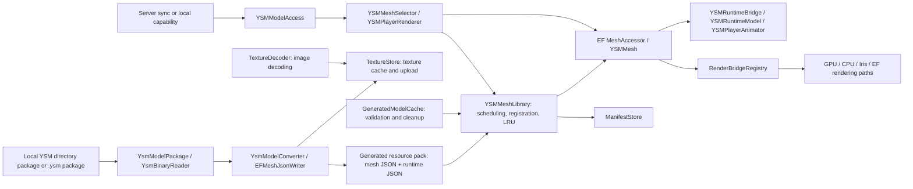
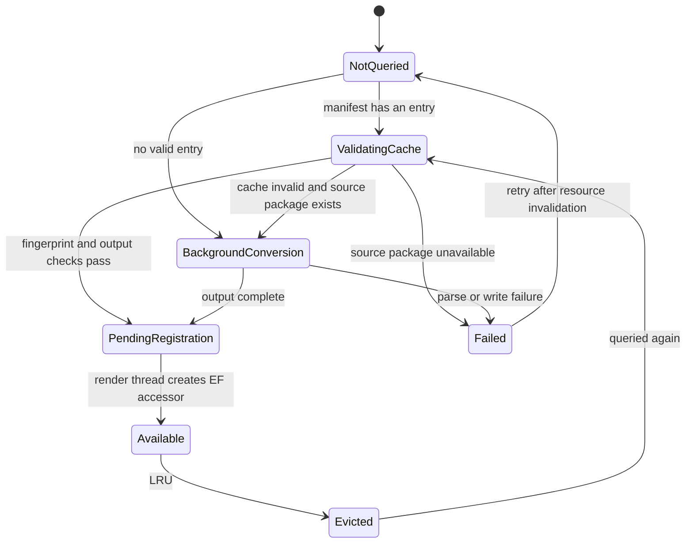

# Architecture and Evolution Constraints

English · [简体中文](ARCHITECTURE.md)

> Baseline: workspace source as of 2026-10-03. Target environment: Minecraft 1.20.1, Forge 47, Epic Fight 20.14.17, and official YSM 2.6.5, OpenYSM, and ModernYSM. This document describes the **current implementation** and the **constraints future changes must follow**; items marked "planned" are not yet implemented. See the [README](../README.en.md) for features and configuration.

## 1. Behavior to preserve

1. Combat mode uses the converted YSM mesh with Epic Fight animations; outside combat, YSM renders on its own. YSM's built-in Steve/Alex models use the vanilla biped model.
2. When there is no model, conversion has not finished, a third-party mod takes over the appearance, or an optional rendering path is unavailable, the existing rendering path may be used as a fallback. The character must never disappear, be drawn twice, or lose its held-item layer.
3. Models load on demand. The first-frame query does no full package decryption, output hash verification, script compilation, image decoding, or large mesh construction; registration happens after the background work completes.
4. Client resources have an explicit owner. Model eviction, resource reload, and disconnect each clean up the state of their own lifecycle, and old tasks never publish results into a newer cache generation.
5. Input may come from model packages, the disk cache, or the server. Bounds checks on paths, sizes, counts, and network fields must not be bypassed for performance.

These are compatibility conditions for new features, not a claim that every current path is already fully proven by automated tests.

## 2. Current components and data flow

| Boundary | Current entry points and responsibilities | Responsibilities that should not be added |
|---|---|---|
| Mod startup and events | [`YSMEpicFightCompat`](../src/main/java/com/ysmef/compat/YSMEpicFightCompat.java), [`YSMCompatClientEvents`](../src/main/java/com/ysmef/compat/event/YSMCompatClientEvents.java), [`YSMReloadTrigger`](../src/main/java/com/ysmef/compat/event/YSMReloadTrigger.java): register configuration, networking, resource packs, render bridges, and lifecycle events | Model parsing, GL details, persistence formats |
| Forks and external APIs | [`YsmFork`](../src/main/java/com/ysmef/compat/ysm/YsmFork.java), `YsmClasses`, `mixin`, `compat`: identify the distribution and isolate differences between YSM, EF, and other mods | Scattering fork checks across geometry conversion, animation rules, and shaders |
| Input and conversion | `ysm` parses packages and scripts; [`YSMGeoModel`](../src/main/java/com/ysmef/compat/model/YSMGeoModel.java), [`EFMeshJsonWriter`](../src/main/java/com/ysmef/compat/model/EFMeshJsonWriter.java), and `YSMJointMapper` generate EF mesh and runtime JSON | Accessing client entities or network connections, creating GL objects |
| Model coordination | [`YSMMeshLibrary`](../src/main/java/com/ysmef/compat/model/YSMMeshLibrary.java): schedules cache restoration, registration, warm-up, LRU, and invalidation per model; [`YsmModelConverter`](../src/main/java/com/ysmef/compat/model/YsmModelConverter.java) converts a single model and returns the result | New parsing formats, script semantics, texture decoding algorithms; the library is still a central point and should keep shrinking |
| Resource ownership | [`ManifestStore`](../src/main/java/com/ysmef/compat/model/ManifestStore.java) owns the manifest; [`GeneratedModelCache`](../src/main/java/com/ysmef/compat/model/GeneratedModelCache.java) validates and cleans generated output; [`TextureStore`](../src/main/java/com/ysmef/compat/model/TextureStore.java) owns texture registration, caching, and upload; [`TextureDecoder`](../src/main/java/com/ysmef/compat/model/TextureDecoder.java) decodes on the CPU; [`MeshReleaseQueue`](../src/main/java/com/ysmef/compat/model/MeshReleaseQueue.java) owns deferred release of evicted meshes | Creating a "second source of truth" for the same resource in another class |
| Runtime animation | `model.runtime` compiles scripts, evaluates them per entity, and handles bones and secondary motion; [`AnimatorEvalInputs`](../src/main/java/com/ysmef/compat/model/runtime/AnimatorEvalInputs.java) captures evaluation inputs; [`YSMRuntimeBridge`](../src/main/java/com/ysmef/compat/model/runtime/YSMRuntimeBridge.java) connects to the draw context | Decrypting model packages, changing the network protocol, directly owning the texture manager |
| Drawing | [`YSMMesh`](../src/main/java/com/ysmef/compat/model/YSMMesh.java) chooses the path; `gpu` and `cpu` implement resources and drawing; [`RenderBridgeRegistry`](../src/main/java/com/ysmef/compat/model/RenderBridgeRegistry.java) and `MeshReleaser` invert the dependency | Writing back to the model cache or manifest from a rendering path |
| Model selection and sync | `network` handles the handshake and broadcasts; [`YSMModelAccess`](../src/main/java/com/ysmef/compat/renderer/YSMModelAccess.java) resolves player selections; `renderer` decides whether to take over and keeps the previous renderer | Reading or writing GL or EF render registries directly from the network thread |

### Existing dependency exceptions

The package names do not yet form a strict layered architecture: `ysm.YsmModelPackage` uses `model.YSMGeoModel`, `model` and `model.runtime` reference each other, and the runtime bridge also reads `renderer.YSMBattleMode`. The package names alone therefore **cannot** be used to claim the code is acyclic. A new cross-package dependency should first establish who owns the data and interface; do not add more reverse references. When splitting packages, move the stable data types first, then the callers, keeping every step compilable. `RenderBridgeRegistry`/`MeshReleaser` already separate `model` from direct imports of `gpu` and `cpu`; keep that boundary when extending drawing paths.

## 3. Model state machine and cache contract

The diagram below shows the **conceptual states** of several existing sets and queues, not an enum that exists in the code. `YSMMeshLibrary` coordinates the states.

- `ensureModel` only queries or submits a task; it returns `false` while the model is not ready, and the renderer uses the fallback mesh. `PENDING_MODELS` stays occupied until the render thread finishes accessor registration, preventing duplicate submissions.
- Background threads may read, validate, decrypt, parse, and write **model-local output**. Epic Fight's `Meshes.ACCESSORS` is a non-thread-safe table; `MeshAccessor.create` must run on the render thread in `drainPendingMeshRegistrations`.
- A cache hit requires the source model fingerprint, generator key, mesh/runtime JSON, and texture cache to all validate. `ManifestStore.CACHE_KEY` is built from `MANUAL_VERSION` and a content fingerprint of the `model/` sources. If code **outside** that directory changes the format or meaning of generated output, `MANUAL_VERSION` must be bumped and the reason explained.
- Lazy manifest updates merge entries on disk that this session has not touched; only `replaceAll` is an explicit full rebuild. Do not let a single model's conversion overwrite the whole manifest.
- Resource reload discards old conversion and registration tasks through `LOAD_GENERATION`. Runtime preloading has its own task tickets and generation; texture decoding/upload has a per-texture token. A new asynchronous stage must carry a verifiable generation or identity, not rely solely on `Future.cancel()`.
- `FAILED_MODELS` marks failures within the current invalidation cycle. Any automatic retry must define backoff, a limit, user-visible logging, and reset behavior after reload.

## 4. Threads, locks, and data handoff

| Where it runs | May do | Must not do |
|---|---|---|
| Client render/main thread | EF accessor registration, mesh warm-up, texture upload/release, GL object creation and destruction, mesh selection, reading live entity state | Hashing large files, decrypting packages, decoding images, compiling scripts in bulk; do not repeat expensive work for the same model every frame |
| Background pools such as `LAZY_POOL` | Input and output file I/O, validation, conversion, texture decoding, precompilation; submitting immutable results or task tickets | Calling `MeshAccessor.create`, touching GL/TextureManager, directly accessing a live `LivingEntity` or render state |
| `ManifestStore` background single writer | Merging and writing manifest snapshots for lazy updates; explicit `generateAll` uses a synchronous `replaceAll` guarded by the same snapshot lock | Performing render work, or depending on a render-thread lock that must wait for this writer |
| Network handler thread | Validating direction, connection version, and packet bounds; handing off to the appropriate main thread with `context.enqueueWork` | Modifying the client world or render registries directly; accepting model selections before the handshake |

Rules:

1. Background work passes a `ModelResult`, an immutable input snapshot, or a resource with explicit ownership; shared objects must state who publishes them, who closes them, and when they expire. `AnimatorEvalInputs` is the input boundary for asynchronous evaluation; when adding a Molang query, capture its value on the render thread first.
2. The `YSMMeshLibrary` class lock guards state transitions; do not add large file I/O or waits on background tasks inside it. If new code touches the library lock, the runtime model cache lock, or texture state together, draw the lock order first; reverse calls must not be able to deadlock.
3. Context must be pushed and popped in pairs. `YSMMeshSelector` sets the entity after a successful selection, and the `finally` in `YSMMesh.draw` clears it; any new early return or exception path must go through the same cleanup.
4. Performance budgets follow the current bounded processing: about 8 ms per tick for mesh warm-up and about 10 ms per drain for texture upload. A budget is a scheduling boundary, not a guarantee that any single GL call can be interrupted; new tasks should be batchable and cancellable or discardable.

## 5. Resource lifecycles and single owners

| Resource | Created/held by | Released or reset when |
|---|---|---|
| EF mesh accessors and the pending registration queue | `YSMMeshLibrary` | LRU eviction or `invalidateAll`; old-generation tasks must not register, and registration and GL release stay on the render thread |
| Model usage order and instantiated-mesh markers | `YsmModelResidency` | Selects the least recently used eviction candidate that is not pending or failed; `invalidateAll` clears it without releasing resources |
| Evicted `YSMMesh` that this frame may still reference | `MeshReleaseQueue` | Deferred release on client tick; cleared and destroyed immediately on full invalidation |
| VBOs, SSBOs, and shader-associated caches of the GPU/CPU/Iris paths | Each rendering path, registered with `MeshReleaser` | Single-mesh eviction or full invalidation, called on the render thread; each path implementation releases idempotently |
| Raw texture bytes, `NativeImage` being decoded, the upload queue, `DynamicTexture` | `TextureStore` | Model eviction, replacement, or full invalidation; once a decode result is queued the queue/uploader takes ownership, and stale tokens must close the image |
| Compiled runtime models, preload tasks | `YSMRuntimeModel` | Single-model replacement, eviction, or full invalidation; old tickets must not republish |
| Per-player animation state | `YSMRuntimeModel`, keyed by UUID | Long unused, model invalidated, or player leaves the world |
| Model geometry and topology for secondary motion | `YsmMeshSecondaryMotion.PreparedModel`, cached with the mesh as a weak key | Collectible after mesh eviction; cleared on resource reload |
| Per-entity secondary motion state | `YsmEntityMotionStates`, weakly keyed by entity object identity and checked against world object identity | Collectible after the entity leaves; recreated on world change; cleared on disconnect or resource reload |
| Manifest entry format | `YsmModelManifestEntry` | Lazy conversion and full generation share the same encoding; field changes should cause the generated cache to revalidate |
| Manifest file and in-memory mirror | `ManifestStore` | The file persists across sessions; background writes must merge versions and must not delete persistent entries because of model LRU eviction |
| Network-synced player selections | `ModelSyncClient` | Cleared on disconnect; **not cleared on F3+T**, because the server does not necessarily resend unchanged selections |

**Invalidation scopes must stay distinct:** model LRU eviction releases only that model's memory and GL state; F3+T and `/ysm model reload` make the model cache revalidate; disconnect clears connection and per-player state. Do not merge the three into a single "clear every static field" method. Resource release must be repeatable, and GL/TextureManager operations stay on the render thread.

## 6. Rendering and compatibility strategy

- The player render slot keeps a single provider. `YSMPlayerRenderer` stores the provider it replaced and delegates to it for players it does not handle; `handles` is a side-effect-free probe, and the actual mesh selection happens in `getMeshProvider`. New appearance conditions go through `LookOwners` first to avoid drawing on top of other mods.
- `YSMRenderHook` suppresses YSM's own player rendering takeover in combat mode so EF uses the vanilla player renderer with its held-item layers. Before changing event priority or cancellation, confirm "who actually draws" and "who only cancels the event".
- `YSMMesh.draw` first handles Real Camera's capture buffer (which requires writing vertices into that buffer); in general it tries the direct GPU path, then chooses the Iris/EF compute path or the CPU fallback based on capability, shader packs, model size, and similar conditions. The return value of a drawing path's `tryRender` means **whether it has already drawn**; when it returns `false` it must not leave partial GL state, a consumed buffer, or an unrestored pose/context behind.
- Only `YsmFork`/`YsmClasses` provide evidence and results for fork identification. The OpenYSM source currently provided uses Forge event handler entry points; the ModernYSM source uses helpers returning `boolean` plus Forge wrapper hooks. `OpenYsm*Mixin` accommodates both signatures, `YsmUnobf*` handles readable targets shared by both forks, and the official obfuscated release uses its own Mixins. Do not guess the fork from a version number, and do not register another set of duplicate Mixins for the same target and signature.
- `require=0` lets an optional target signature be absent, but method drift can also fail silently. When changing an external mod entry point, update [`MixinTargetSignatureTest`](../src/test/java/com/ysmef/compat/contract/MixinTargetSignatureTest.java), prove the signature against the corresponding source or released jar, and verify the event behavior in game. The source test verifies declarations and the jar test verifies bytecode; neither replaces runtime rendering verification.

### Responsibility boundaries for secondary motion

- `YsmPhysicsParts` builds parts from model bones and meshes; `YsmHeadContactConstraint` decides whether geometry touching the head stays rigid, with the contact measurements supplied by the separate `YsmContactGeometry`, which must not depend back on `YsmPhysicsParts` or the per-frame solver; `YsmPhysicsTopology` only computes chain size and neighboring panels; `YsmPhysicsMotionLimits` provides the whole-chain budget and drag limits by part type. Rules are based on geometry and type, not branches on individual model IDs.
- The same `YSMMesh` is drawn by many entities. Model geometry, chain topology, and the bind shape of colliders can be shared; integrator state, frame time, current collider positions, and output matrices must belong to each entity. Physics caches must not be keyed by mesh or UUID alone: the same UUID can appear in different saves, and even if an entity reuses its object, its state must be rebuilt when the world object changes.
- `YsmDynamicBoneSolver` integrates a single pendulum and handles the center of mass and body collisions; `YsmPhysicsCoupling` propagates swing between neighboring panels relative to each panel's rest pose, not by averaging absolute orientations, which would erase the skirt's original flare; `YsmMeshSecondaryMotion` orchestrates EF poses, collisions, coupling, limits, and the final mesh transforms. After coupling or limits change a direction, the solver state, logged angles, and drawn quaternions must all point to the same result; body collisions must be rechecked after coupling.
- A garment chain must not simply add up per-joint maximum angles, or a three-segment short skirt chain could fold to 120°. A leg capsule must not be skipped entirely just because the skirt root lies inside the leg; only collisions that cannot be satisfied, because the rest center of mass is already inside the capsule, are skipped. New physics rules must verify at least these two invariants with real models and running input.

## 7. Extension rules: where to change, and what must change with it

| Change | Entry point | Side effects to check |
|---|---|---|
| New YSM package format, encryption, or resource type | `ysm` parsing layer | Input size/path guards; directory and binary package samples; error fallback; whether generated output changes as a result |
| New geometry or joint mapping | `YSMGeoModel`, `EFMeshJsonWriter`, `YSMJointMapper`, `JointTable` | Mesh/runtime JSON, bind pose invariants, EF joint count limit, cache key, real-model golden tests |
| New animation query, state, or physics rule | `YSMRuntimeModel`, `YSMPlayerAnimator`, the relevant `YsmPhysics*` | Asynchronous `AnimatorEvalInputs` snapshot, per-player state release, combat/non-combat semantics, deterministic tests and real-model samples |
| New rendering path | `RenderBridgeRegistry` implementation, `MeshReleaser`, client setup registration | `tryRender` return semantics, GL state restoration, release on eviction/reload, Real Camera and shader/outline fallback |
| New YSM/EF fork or Mixin | `YsmFork`, `mixin`, any necessary reflection adapter | Unique fork evidence, source and released jar signatures, silent failure risk of `require=0`, rendering matrix across the three forks |
| New network message or field | `network` and `message` | Protocol version, rejection before handshake, length/count limits, direction, main-thread handoff, disconnect cleanup |
| New cache or static map | The owning component | Single owner, key and memory limit, invalidation triggers, cross-world cleanup, notes on concurrent reads and writes |

**Code review gate:** new state must answer "who owns it, which thread reads and writes it, when it expires, and what it falls back to on failure"; a new cross-package call must answer "why the interface belongs on the depended-upon side"; new reflection or a new Mixin must include target evidence and compatible versions. An implementation that does not answer these questions needs a design note first; "we'll clean it up later" is not a reason to merge it.

Commit messages must at least state: the data flow and owners involved, thread handoff and cancellation, cache key/invalidation impact, failure fallback, automated test results, and in-game combinations not yet covered. New paths must not use an empty `catch` that silences failures; degrading is fine, but it should produce rate-limited diagnostics with model or fork context.

## 8. Verification and pre-release checks

### Automated checks

1. For routine changes, run `./gradlew test`. For converter or parser changes, add real-model/golden samples so the tests do not only exercise your own implementation details.
2. For changes to official obfuscated release targets, run the default jar signature contract. For changes to OpenYSM/ModernYSM targets, run `MixinTargetSignatureTest` with `-Dysmef.fork=open|modern` plus `-Dysmef.fork.source=<source root>` or `-Dysmef.fork.jar=<released jar>`. See the README for the full commands.
3. When changing the generated format, check the `CACHE_KEY` change and how old manifests are rebuilt; when changing asynchronous or release logic, test "invalidated/replaced before the task completes" and double release.

### Minimum in-game matrix

Automated tests cannot simulate real GL, EF event ordering, or composition with third-party Mixins. Changes involving rendering, resources, or forks must cover at least:

| Dimension | Required scenarios |
|---|---|
| Forks | Official YSM, OpenYSM, ModernYSM; safe startup without YSM installed |
| Models | No model, built-in Steve/Alex, custom directory package, encrypted `.ysm`; first load, cache hit, switching models |
| Rendering | Combat/non-combat, third/first person, held-item and armor layers, GPU toggle, shader pack/CPU fallback, Real Camera capture |
| Lifecycle | Rejoining after LRU eviction, F3+T, `/ysm model reload`, rapid consecutive switching, disconnecting and joining another world |
| Optional compatibility | EFTLM maids; delegation and restoration when another mod takes over the appearance |
| Multiplayer | Servers with and without this mod, handshake version mismatch, remote players changing models and reconnecting |

When recording results, also save the YSM fork detection, registered rendering paths, model IDs, and fallback reasons from the log. **A passing test only proves the combinations tested; forks and GL paths that were not run must be named in the release notes.**

## 9. Planned decomposition order

These are goals for lowering the cost of future changes, **not a requirement for an immediate large-scale rewrite**:

1. **Fix the contracts first, then split classes.** Establish small, stable data contracts for model load results, cache entries, and render resource handles; keep the external `YSMMeshLibrary` entry points so all callers do not have to change at once.
2. **Keep shrinking `YSMMeshLibrary`.** Output validation and cleanup have moved to `GeneratedModelCache`, and single-model conversion to `YsmModelConverter`; LRU data and eviction selection now belong to `YsmModelResidency`, and lazy conversion and full generation share the `YsmModelManifestEntry` encoding. The library keeps the load state machine, render-thread registration, and actual resource release; it can be split further into background cache restoration and render-thread merge stages.
3. **Keep separating the disk and GL stages of `TextureStore`.** Image decoding has moved to `TextureDecoder`; file layout/caching and TextureManager registration remain in `TextureStore`. Further splits must preserve the token, `NativeImage` handoff, and deferred release semantics.
4. **Tighten runtime dependencies.** Input capture for `YSMPlayerAnimator` has moved to `AnimatorEvalInputs`; next, pure evaluation and existing reverse references such as `model.runtime -> renderer` should gradually become explicit inputs. Physics rules should first be divided between data and solver, not accumulate exceptions by model name.
5. **Leave replaceable entry points in the compatibility layer.** Keep fork detection, Mixin targets, reflection APIs, and their tests in the same change; for a new fork, establish evidence and a failure fallback first, then connect it to the core paths.

Each step is complete when callers no longer need to know about the extracted internal state, cache invalidation and release order are unchanged, and all three kinds of tests (unit, signature contract, the necessary in-game matrix) have results. Do not move every class at once just to tidy up the directory structure.
